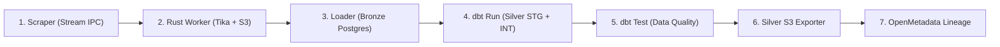

# 🥈 Arquitectura de Capa Silver en 2 Fases (Staging & Intermediate) + Persistencia Dual

## 1. Visión y Objetivos

En cumplimiento con los requerimientos del proyecto de **Opportunity Intelligence (IDCI)** y las directrices normativas de [`informacion.md`](file:///Users/edissonmorocho/practicaspp/IDCI/informacion.md) y [`ContextoParaDags.md`](file:///Users/edissonmorocho/practicaspp/IDCI/ContextoParaDags.md), la **Capa Silver** se divide estrictamente en **dos fases desacopladas por cada DAG / Institución**:

1. **Fase 1: Staging (`{institución}_{dimensión}_stg`) — Vistas SQL**:
   - Vistas de desempaquetado de primer nivel desde la tabla Bronze correspondiente.
   - Tipado y proyección de atributos crudos (`_raw`) sin alterar el significado de los datos de origen.
   - Preservación íntegra de metadatos de auditoría (`_landing_uri`, `_batch_id`, `_extracted_at`).

2. **Fase 2: Intermediate (`{institución}_{dimensión}_int`) — Tablas Físicas**:
   - Deduplicación determinística basada en clave primaria inmutable (`call_code` / `source_id`).
   - Normalización de fechas e hitos a zona horaria universal **UTC (ISO 8601)**.
   - Regla estricta de incertidumbre: inyección controlada de `'unknown'` ante información ausente, confidencial o no declarada.
   - No eliminación de oportunidades cerradas (preservación histórica).
   - Tipado fuerte y materialización en tablas relacionales dentro de PostgreSQL (`schema: silver`).

3. **Persistencia y Sincronización Dual (PostgreSQL + RustFS S3)**:
   - Todo modelo transformado intermedio (`_int`) y dimensional consolidado (`marts`) reside físicamente en **PostgreSQL 16**.
   - Automáticamente, tras la ejecución de dbt y sus pruebas de calidad, el componente `export_silver_to_s3.py` exporta los datos transformados a **RustFS S3** con particionamiento temporal tipo Data Lake (`year=YYYY/month=MM/`) y un puntero unificado `latest.json`.

---

## 2. Cobertura de Dimensiones según `informacion.md`

Cada institución cuenta con 5 modelos especializados en Staging (`_stg`) y 5 en Intermediate (`_int`), cubriendo los pilares analíticos de la plataforma:

| Entidad / Dimensión | Nombre de Tabla (`_stg` / `_int`) | Propósito Analítico y Reglas Clave |
| :--- | :--- | :--- |
| **Identidad, Estado y Modalidad** | `{inst}_opportunities_stg`<br>`{inst}_opportunities_int` | `call_code` inmutable, título en idioma original, resumen, modalidad (`grant`, `procurement`, `network`), estado normalizado (`OPEN`, `CLOSED`, `ANTICIPATORY`, `OTHER`), vigencia (`is_active`). |
| **Actores y Roles Contextuales** | `{inst}_actors_stg`<br>`{inst}_actors_int` | Entidades involucradas con rol explícito (`financiador`, `agencia_ejecutora`, `autoridad_contratante`, `socio`). |
| **Condiciones Financieras** | `{inst}_financial_conditions_stg`<br>`{inst}_financial_conditions_int` | Presupuestos, montos mínimos y máximos, tasa de cofinanciamiento, duración estimada, moneda original (USD, CAD, EUR) sin conversiones arbitrarias. |
| **Fechas e Hitos Temporales** | `{inst}_milestones_stg`<br>`{inst}_milestones_int` | Fechas de publicación, aclaraciones, recepción y cierre convertidas a UTC. Cálculo de `days_remaining`. Si no consta, `'unknown'`. |
| **Documentos Oficiales / Evidencia** | `{inst}_documents_stg`<br>`{inst}_documents_int` | Pliegos, términos de referencia y anexos oficiales descargados a S3 con URI persistente (`s3://...`), nombre de archivo y hash de integridad SHA-256. |

---

## 3. Inventario Completo de Modelos Silver por DAG

### 3.1. IDRC (Canadá) — `idrc_funding_pipeline_dag`
- **Fase 1 (`_stg` Vistas):**
  - `silver.idrc_opportunities_stg`
  - `silver.idrc_actors_stg`
  - `silver.idrc_financial_conditions_stg`
  - `silver.idrc_milestones_stg`
  - `silver.idrc_documents_stg`
- **Fase 2 (`_int` Tablas):**
  - `silver.idrc_opportunities_int`
  - `silver.idrc_actors_int`
  - `silver.idrc_financial_conditions_int`
  - `silver.idrc_milestones_int`
  - `silver.idrc_documents_int`

### 3.2. CYTED (Iberoamérica) — `cyted_funding_pipeline_dag`
- **Fase 1 (`_stg` Vistas):**
  - `silver.cyted_opportunities_stg`
  - `silver.cyted_actors_stg`
  - `silver.cyted_financial_conditions_stg`
  - `silver.cyted_milestones_stg`
  - `silver.cyted_documents_stg`
- **Fase 2 (`_int` Tablas):**
  - `silver.cyted_opportunities_int`
  - `silver.cyted_actors_int`
  - `silver.cyted_financial_conditions_int`
  - `silver.cyted_milestones_int`
  - `silver.cyted_documents_int`

### 3.3. Banco Mundial (World Bank Group) — `worldbank_procurement_pipeline_dag`
- **Fase 1 (`_stg` Vistas):**
  - `silver.worldbank_opportunities_stg`
  - `silver.worldbank_actors_stg`
  - `silver.worldbank_financial_conditions_stg`
  - `silver.worldbank_milestones_stg`
  - `silver.worldbank_documents_stg`
- **Fase 2 (`_int` Tablas):**
  - `silver.worldbank_opportunities_int`
  - `silver.worldbank_actors_int`
  - `silver.worldbank_financial_conditions_int`
  - `silver.worldbank_milestones_int`
  - `silver.worldbank_documents_int`

### 3.4. UNGM (UN Global Marketplace) — `ungm_funding_pipeline_dag`
- **Fase 1 (`_stg` Vistas):**
  - `silver.ungm_opportunities_stg`
  - `silver.ungm_actors_stg`
  - `silver.ungm_financial_conditions_stg`
  - `silver.ungm_milestones_stg`
  - `silver.ungm_documents_stg`
- **Fase 2 (`_int` Tablas):**
  - `silver.ungm_opportunities_int`
  - `silver.ungm_actors_int`
  - `silver.ungm_financial_conditions_int`
  - `silver.ungm_milestones_int`
  - `silver.ungm_documents_int`

### 3.5. Modelos Consolidados (Marts Kimball Multi-Institucional)
- `silver.int_opportunities__unified`: Vista/tabla intermedia canónica que realiza la unión universal de las 4 fuentes.
- `silver.fct_opportunities`: Tabla de hechos unificada.
- `silver.dim_opportunity_actors`: Dimensión conformada de actores.
- `silver.dim_opportunity_contexts`: Dimensión conformada de programas y áreas temáticas.
- `silver.dim_opportunity_financial_conditions`: Dimensión conformada de condiciones presupuestarias.
- `silver.dim_opportunity_milestones`: Dimensión conformada de hitos y plazos temporales.
- `silver.dim_opportunity_documents`: Dimensión conformada de pliegos y anexos probatorios.
- `silver.v_opportunities_consolidated`: Vista analítica lista para APIs y plataformas de consumo final.

---

## 4. Persistencia Dual en RustFS S3

El módulo [`src/extractor/export_silver_to_s3.py`](file:///Users/edissonmorocho/practicaspp/IDCI/src/extractor/export_silver_to_s3.py) se ejecuta de forma nativa como tarea en los pipelines de Airflow inmediatamente después de la validación de pruebas con dbt:

### 4.1. Estructura de Rutas en RustFS S3
```text
s3://opportunity-intelligence/silver/
├── {institution}/
│   └── {table_name}/
│       ├── year=YYYY/month=MM/
│       │   └── data_{YYYYMMDDTHHMMSSZ}.json
│       └── latest.json
└── marts/
    └── {dim_or_fct_table}/
        ├── year=YYYY/month=MM/
        │   └── data_{YYYYMMDDTHHMMSSZ}.json
        └── latest.json
```

### 4.2. Características de la Exportación S3:
- **Particionamiento Hive-compatible (`year=YYYY/month=MM/`)**: Facilita consultas federadas mediante DuckDB, Trino o AWS Athena.
- **Puntero `latest.json`**: Permite al Front-end, Agentes LLM o APIs consumir directamente la última versión transformada sin listar prefijos temporales.
- **Tolerancia a Vacíos (Zero-Error)**: Si una tabla está vacía en fase inicial o tras un reset, genera un snapshot válido `[]` con metadatos de conteo `0` sin romper la tubería.
- **Serialización Segura**: Decodifica automáticamente fechas a ISO8601, tipos Decimal de PostgreSQL a Float y cadenas binarias a UTF-8.

---

## 5. Orquestación en Airflow

La secuencia estándar de tareas en todos los DAGs se ejecuta bajo aislamiento efímero en 7 pasos:



1. `run_ephemeral_scraper` / `run_scraper_api`: Extrae el HTML / API y genera el flujo de datos.
2. `run_ephemeral_rust_worker`: Valida hashes, despacha documentos a Apache Tika y persiste en S3 Landing.
3. `run_ephemeral_loader`: Ingesta atómica a la tabla Bronze correspondiente (`bronze.*`).
4. `run_ephemeral_dbt_models`: Ejecuta dbt generando vistas `_stg`, tablas `_int` y marts consolidados.
5. `run_ephemeral_dbt_tests`: Ejecuta suite de calidad verificando no nulos, unicidad y valores aceptados.
6. `run_export_silver_s3`: Descarga los datos transformados de `silver.*` en Postgres y los publica particionados en RustFS S3.
7. `run_ephemeral_metadata`: Publica linaje end-to-end certificado en OpenMetadata.
