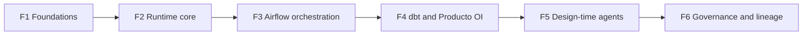

# Implementation plan (Producto OI)

Source: `Contex.md` / `AGENTS.md`. Every phase respects the five invariants (zero AI at run-time, single
source of contracts, stealth with playwright + obscura.sh, stream-to-Rust with binary triage, HITL gates).

| Phase | Scope | Exit criteria |
| :--- | :--- | :--- |
| **F1 Foundations** (built) | Repo, contract loader/validator, dossier scaffold, Python base package, Rust `source_runtime` skeleton, local infra, CI | `pytest`, `cargo test`, `make new-ingestion` and `docker compose config` pass; no-LLM guard green |
| **F2 Runtime core** (built) | Python extractor -> stream to RustWorker (in front of RustFS) -> SHA-256 -> triage: complex binaries (PDF/DOCX) through Tika first, the rest direct -> RustFS Landing (Hive partitions); JSON records to the typed `bronze.<source>__<dataset>` table of their dataset (F4), rejects to quarantine | End-to-end smoke on one fixture source; hash recorded; Tika called only for PDF/DOCX |
| **F3 Orchestration** (built) | Airflow with declarative YAML DAGs generated from contracts at design-time | DAGs parse; no LLM import in DAG code; schedule driven by YAML |
| **F4 dbt / Producto OI** (built) | Staging, Intermediate and Producto OI models; tests from contract quality rules | `dbt build` green on fixtures; tests generated, not hand-written |
| **F5 Design-time agents** (built) | `source-scout`, `source-assessor`, `silver-designer`, `arch-reviewer`; playwright probes; gate H1/H2 tooling | A new source goes Discovery -> PR with two human sign-offs recorded in `state.yml` |
| **F6 Governance** | OpenMetadata ingesting Airflow logs and dbt `manifest.json`; 5-layer lineage | Lineage visible end to end for the pilot source |

## F5 deliverables

- **Agents** (`.claude/agents/`, read by Claude Code and Cursor): `source-scout` (Discovery), `source-assessor` (Assessment), `silver-designer` (contract and blueprint) and `arch-reviewer` (independent review). `.claude/skills/new-source` is the interactive guided workflow that coordinates them, interviews the user, handles decision gates H1/H2, and compiles artifacts; `.cursor/rules/design-agents.mdc` summarizes it.
- **Tooling the agents call** (`scrapagents.design`, all deterministic, no LLM):
  - `make probe ID= URL=`: stealth probe through `StealthRouter` (playwright connected to Obscura over CDP); also reads `robots.txt`; appends the evidence rows to `discovery.md`.
  - `make status ID=`: phase, missing evidence, pending human gate. Evidence checks: every `- Label:` answered (a `TODO` is not an answer), well-formed probe rows, payload table consistent with invariant 4 (only PDF/DOCX to Tika), `go`/`no-go` decision.
  - `make review ID=`: writes `review.md`: blueprint complete (identity, owner, contracts valid under the project rules, `bronze_table` naming, one Pool per site, dbt selector, Tika list equal to the assessment, stealth for web sources), no duplicate acquisition path in `configs/`, personal data consistent between assessment and contracts, invariants 1 and 3 in any Python of the dossier, and a dry run of the bronze tables, dbt models and DAG generated from the draft. It records a digest of what it reviewed; the `arch-reviewer`'s judgement is kept under `## Reviewer notes`.
  - `make advance ID=`: moves `phase` only when the evidence is complete **and** the closing gate is signed (H1 for assessment, H2 for blueprint, with a current review).
  - `make sign ID= GATE= BY=`: **human only**; the only code that writes `approved_by`. It refuses agent shells (`CLAUDECODE`, `CURSOR_AGENT`, `CURSOR_CONVERSATION_ID`) and non-interactive terminals, asks to type the gate name, refuses agent-like names, and refuses a gate whose evidence is incomplete or whose review is stale.
  - `make check-contracts` also validates `ingestions/<id>/contracts/*.yml`.
- Exit criterion (`python/tests/test_design_workflow.py`): a new source goes Discovery -> Implement with two human signatures recorded in `state.yml`, and every shortcut (skipping a gate, signing early, a stale review, an agent-like signer) is refused.
- Limits, stated honestly: the `sign` guard is a brake against an agent signing by mistake, not a security boundary (a person can edit `state.yml`; CI cannot tell who typed it, only that `make check-gates` passes); Cursor does not document `tools:` for subagents, so the real restrictions are code, not prompt permissions; `make advance` checks the implement phase only by existence (config, valid contracts, extractor package); verify is run by a human who then signs the PR gate; probes have not been run through a real Obscura instance yet (only `OBSCURA_CDP_URL` is assumed: no Obscura container is defined in `infra/` until its image is confirmed); `landing_format: jsonl` (used by some CEDIA datasets) is rejected because the RustWorker loads JSON only.

## F4 deliverables

- **Typed bronze** (shape modelled on CEDIA's): one table per dataset, `bronze.<source_system>__<dataset>`, with the key columns (TEXT), `payload` (JSONB) and `_ingested_at`, `_batch_id`, `_landing_uri`, `_record_hash`; primary key `(keys, _batch_id)`.
  - `scrapagents generate-bronze` (`make generate-bronze`, `make check-bronze`) generates `bronze/tables.sql` (idempotent DDL, applied by `make bronze-apply` and by `make infra-up`) and `bronze/registry.json` (which datasets have a table and which columns are the key) from the contracts. The key is the contract's `primary_key`.
  - The RustWorker reads the registry at start-up (`BRONZE_REGISTRY`). A JSON payload (array, `{"records": [...]}` or one object) of a registered dataset is split into records and loaded in one atomic statement. The batch is the payload: `_batch_id` is derived from its SHA-256, so replays insert nothing. A record without its key or a duplicate key rejects the whole payload to quarantine (`max_reject_percentage: 0`); the bytes stay in Landing.
  - JSON of an unregistered dataset, and CSV/HTML/XML, are landed in RustFS but not loaded into a table (the receipt has `bronze_table: null`). `bronze.raw_records` no longer exists.
- `dbt/`: project `scrapagents_oi` (dbt-core 1.12.3, dbt-postgres 1.10.1) with layers bronze -> `staging` -> `intermediate` -> `producto_oi`. Models read bronze through generated `source()` definitions.
- `scrapagents generate-dbt` (`make generate-dbt`, `make check-dbt`): generates sources, staging and intermediate models, YAML and tests from contracts. The generated files carry a header and CI fails on drift or orphans.
  - `required`/primary key -> `not_null`; single primary key -> `unique` on the intermediate "current" model; grain test `(pk, bronze_batch_id)` on staging; composite keys get a singular pk test; personal/sensitive columns get the `pii` tag.
  - Staging carries `bronze_batch_id`, `bronze_record_hash`, `bronze_landing_uri`, `bronze_ingested_at`. Mixed-case contract columns (e.g. SIA `COLA_Codigo`) are quoted.
- Producto OI models are hand-designed (the `silver-designer` agent automates them in F5): `producto_oi/fixture/oi_fixture_catalog`. **A Producto OI model of a real source needs gates H1 and H2 signed by a human**: `make check-gates` fails if `dbt/models/producto_oi/<id>/` exists without `ingestions/<id>/` having both approved (only the harness `fixture` is exempt).
- Airflow: the Airflow image carries dbt in `/opt/dbt-venv` (Python 3.12); a DAG with `dbt.selector` gets a `dbt_build` task after `landed`. `make smoke-f3` proves Airflow -> RustWorker -> typed bronze -> staging -> intermediate -> producto_oi.
- `make dbt-check-catalog`: generates the bronze tables and the dbt models for every contract in `configs/contracts` and runs `dbt build` in a throw-away database.
- Not in F4: OpenMetadata publication (F6); Producto OI marts for real sources (need H1/H2 per source).

### Decision: one generated DAG per source

Each ingestion config (one institution) becomes its own DAG `ingest__<id>`; the datasets of that source are tasks inside it. One project ingests many websites, but not through one DAG:

- Failure, retries and schedule are per institution: a portal that is down or changes its HTML must not block or fail the others, and each source has its own cadence.
- The anti-bot and rate limits are per site: each DAG has its own Airflow Pool (`airflow.pool`, `pool_slots`), which is how stealth traffic to a site is throttled.
- `dbt.selector` (`tag:source_<id>`), ownership, lineage in OpenMetadata and gates H1/H2/PR are per source; a DAG exists only for a source whose dossier passed its gates.
- It costs nothing to maintain: DAGs are generated from `ingestions/<id>/ingestion.yml` (one YAML file per DAG, as the Airflow YAML importer expects), never hand-written. Adding a source adds a file; no shared DAG changes.
- A single DAG for all sources would need dynamic task generation at run-time (non-declarative) and couples every source to one failure domain and one schedule.

## F3 deliverables

- Airflow **3.4.0** (latest stable on 2026-11-09), stack `infra/orchestration` (`airflow-db`, `airflow-init`,
  `airflow-api-server`, `airflow-scheduler`, `airflow-dag-processor`; LocalExecutor). The image
  (`infra/orchestration/Dockerfile`) adds the `scrapagents` package. The YAML importer is **opt-in** in Airflow:
  `AIRFLOW__DAG_PROCESSOR__DAG_IMPORTER_CONFIGS` enables `airflow.sdk.importers.yaml_importer.YamlDagImporter`.
- `scrapagents.dags` (`make generate-dags`): Jinja2 template + validation that turn an ingestion config into
  `dags/ingest__<id>.yml` (`$schema` `.../schemas/dag/2026-10-30.json`). Input: a
  `configs/ingestions/<id>.yml`, or the blueprint of a dossier whose **Gate H2 is approved with a named approver**.
  Tasks: `runtime_ready` -> `land__<dataset>` (one per dataset, in the config's Pool) -> `landed`. Schedule, retries,
  retry delay, `max_active_runs`, Pool and timeout come from the config's `airflow` section. Only `BashOperator`
  and `EmptyOperator` are generated; `dags/_pools.json` feeds `airflow pools import`.
- The landing partition of a run is `dag_run.logical_date or dag_run.run_after`: Airflow 3 manual runs have no
  `logical_date`, so `{{ ds }}` does not exist there.
- `ingestions/_fixture/ingestion.yml` (harness-only source) gives the committed `dags/ingest__fixture.yml`.
  Every `configs/ingestions/<id>.yml` also gets a committed DAG (`make generate-dags`); `make airflow-parse` loads them
  in the real Airflow image. Their `land` command defaults to `python -m scrapagents.extractors.<id>` (a package of
  this repository), which needs the `extractors` extra in the Airflow image.
- `make check-dags` (in `make validate`) fails when `dags/` drifts from its sources; `make smoke-f3` triggers
  `ingest__fixture` and checks bronze/quarantine; `no-LLM` tests also scan `dags/*.yml`.
- Not in F3: the `dbt build` step and Silver publication (F4), OpenMetadata publication (F6).

## F2 deliverables

- `rust/source_runtime`: HTTP service (`source_runtime serve`, axum) with real sinks: `s3` (RustFS Landing,
  Hive keys `source=/dataset=/dt=/sha256=`), `pg` (typed bronze tables, see F4, and quarantine) and `tika`
  (Tika Server over HTTP). Triage runs before loading: PDF/DOCX go through Tika first and, if Tika fails,
  nothing is loaded; malformed JSON is quarantined. Container image in `rust/source_runtime/Dockerfile`,
  service `source-runtime` in the `ingestion` stack (configuration through environment variables).
- Transport: `POST /v1/ingest/{source}/{dataset}` with a chunked body and the headers `X-Ingest-Date`,
  `Content-Type`, `X-Filename`; the answer is the receipt (`sha256`, `object_key`, `route`, `text_key`).
  The body is buffered in the worker up to `RUNTIME_MAX_BODY_BYTES` (256 MiB by default), because hashing,
  triage and Tika need the whole payload.
- Python: `HttpRuntimeClient` (stdlib, streams chunks) and `extractors.fixture.FixtureExtractor`.
- `make smoke` (`python/tests/test_smoke_f2.py`): fixture source end to end against the real stacks.

## F1 deliverables

- `configs/contracts`, `configs/ingestions`: the contracts and source declarations of this repository (no CEDIA submodule).
- `python/scrapagents`: `contracts` (load and validate contracts), `stealth` (`StealthRouter`),
  `runtime_client` (byte streaming interface to the RustWorker), `dossier` (state machine and gate checks).
- `ingestions/_template` and `scripts/new_ingestion.py`: design-time dossier per source.
- `rust/source_runtime`: `hashing`, `triage`, `sinks` with unit tests.
- `infra/<stack>/docker-compose.yml`: one compose project per domain on the shared network `scrapagents_net`: `warehouse` (PostgreSQL), `ingestion` (RustFS, Tika). F3/F4/F6 add `orchestration` (Airflow), `transformation` (dbt), `governance` (OpenMetadata). Versions in `infra/.env.example`.
- `.github/workflows/ci.yml`, `.cursor/rules/`.

## Open items (need a human decision)

- Differences with CEDIA (reference only): see `docs/cedia-alignment.md`.
- Obscura (`obscura.sh`) is a headless browser in Rust; Playwright connects to it over CDP (`OBSCURA_CDP_URL`).
  Confirmed 2026-11-09 with image `h4ckf0r0day/obscura:0.2.6`: CDP on port 9222, bearer token
  (`OBSCURA_CDP_TOKEN`, at least 32 bytes) required. Still to do: add an Obscura service to
  `infra/ingestion` (the token must come from the secret manager, not from `infra/.env`).
- Change-only persistence (tombstones, `max_delete_percentage`) declared for `idrc` is not enforced: the worker
  inserts with `ON CONFLICT DO NOTHING`. Decide whether to implement it in the worker or in a dbt layer.
- The extractor needs `playwright` and `beautifulsoup4` (`pip install .[extractors]`) in the image that runs it.

## F7 deliverables (independence from CEDIA, first real source `idrc`)

- `vendor/cedia` removed. Contracts and declarations live in `configs/`; CEDIA is only a reading guide.
- `idrc` implemented here: `configs/contracts/idrc/funding_opportunities.yml`, `configs/ingestions/idrc.yml`,
  `python/scrapagents/extractors/idrc/` (parser, polite fetcher through the Obscura router, extractor).
- Raw bytes: landing-only dataset `funding_opportunities_raw` (original xml/html, never sent to Tika), instead of the
  "side objects" wording of the signed blueprint, because the worker has no side-object endpoint.
