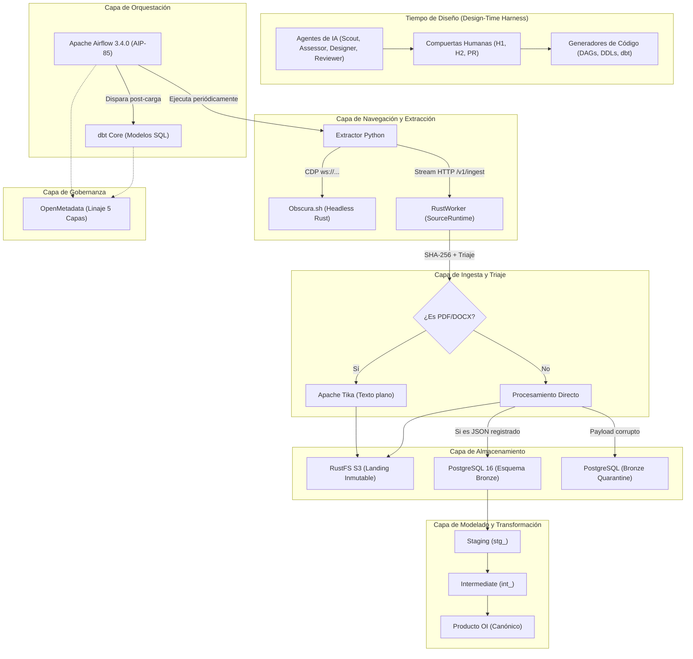
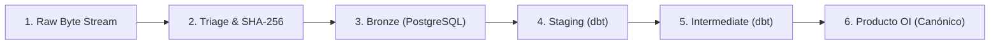

# Resumen Ejecutivo de Arquitectura, Flujo de Datos y Requerimientos de Producto
**Proyecto:** ScrapAgents — Plataforma de Ingesta, Normalización y Gobierno para Producto OI (Opportunity Intelligence)

---

## 1. Visión General y Principios Invariantes

La plataforma está diseñada para ingerir, validar, transformar y gobernar datos no estructurados y estructurados desde portales y APIs institucionales externas hacia un producto analítico unificado (**Producto OI**).

> [!IMPORTANT]
> **Invariante 1: Zero AI at Run-Time (Cero IA en Tiempo de Ejecución)**  
> La Inteligencia Artificial opera exclusivamente en **tiempo de diseño (Design-Time)** para analizar páginas web, modelar esquemas y generar código determinista. En **tiempo de ejecución (Run-Time)**, el sistema es 100% determinista: no existen llamadas a LLMs ni lógicas dinámicas dentro de extractores de producción, DAGs de Airflow ni modelos de dbt.

### Los 5 Invariantes Arquitectónicos Obligatorios:
1. **Zero AI at Run-Time:** Extractores, DAGs y transformaciones operan sin dependencias de modelos de lenguaje en producción.
2. **Single Source of Truth para Contratos:** Todos los esquemas y reglas de calidad residen en [configs/contracts/](file:///Users/edissonmorocho/practicaspp/ScrapAgents/configs/contracts/) y [configs/ingestions/](file:///Users/edissonmorocho/practicaspp/ScrapAgents/configs/ingestions/).
3. **Navegación Sigilosa con Obscura ([`obscura.sh`](https://obscura.sh)):** Todo acceso a navegadores se realiza mediante Playwright conectado vía Chrome DevTools Protocol (CDP) a una instancia de Obscura (navegador headless en Rust con técnicas anti-detección).
4. **Stream-to-Rust e Integridad con Triaje Binario:** Los extractores transmiten flujos de bytes crudos al binario nativo [SourceRuntime / RustWorker](file:///Users/edissonmorocho/practicaspp/ScrapAgents/rust/source_runtime/). Este calcula el hash SHA-256 en vuelo y realiza triaje: **únicamente documentos binarios complejos (PDF, DOCX) pasan por Apache Tika**; el resto se almacena directamente.
5. **Compuertas Humanas Estrictas (Human-in-the-Loop):** Dos compuertas obligatorias (**H1** para viabilidad legal/ToS y **H2** para contrato y arquitectura) exigen la firma explícita de un humano en terminal antes de generar código.

---

## 2. Arquitectura del Sistema por Capas

El proyecto se estructura en 6 capas modulares e independientes:



### Detalle de Componentes:

| Componente | Tecnología | Responsabilidad |
| :--- | :--- | :--- |
| **Design Harness** | Python + Agentes Claude/Cursor | Explora sitios web, analiza términos legales, modela contratos de datos y compila artefactos. |
| **Navegador Sigiloso** | Obscura (`obscura.sh` en Rust) | Ejecuta el motor V8 y expone CDP en puerto `9222`. Minimiza consumo de memoria (~30 MB) y elude bloqueos anti-bot. |
| **Motor de Ingesta** | Rust 1.80 (`tokio`, `sha2`, `axum`) | Ubicado delante del almacenamiento; valida integridad por SHA-256, gestiona el triaje binario y alimenta Landing y Bronze. |
| **Extractor Binario** | Apache Tika 4.1.0 | Servicio HTTP (puerto `9998`) invocado **únicamente** para extraer texto plano (`.txt`) de PDFs y DOCXs. |
| **Data Lake (Landing)** | RustFS S3 | Almacén inmutable de objetos bajo particionamiento Hive (`source=/dataset=/year=/...`). |
| **Data Warehouse** | PostgreSQL 16 | Aloja las tablas tipadas `bronze.<fuente>__<dataset>` (`payload JSONB` + linaje) y la tabla `bronze_quarantine`. |
| **Orquestador** | Apache Airflow 3.4.0 | Carga DAGs declarativos YAML nativos sin código Python (`dags/ingest__<id>.yml`). |
| **Transformación** | dbt Core 1.12.3 (`dbt-postgres`) | Ejecuta transformaciones modulares en tres capas: Staging, Intermediate y Producto OI. |
| **Catálogo y Linaje** | OpenMetadata 1.4.2 | Traza el linaje de extremo a extremo consumiendo manifiestos de dbt y eventos de Airflow. |

### 2.1 Nueva Arquitectura de Contenedores Unificada (`docker-compose.yml`)

Siguiendo el patrón arquitectónico de la plataforma de datos de CEDIA (`deploy/local/docker-compose.yml`), todos los servicios locales están ahora consolidados en un **único archivo [`docker-compose.yml`](file:///Users/edissonmorocho/practicaspp/ScrapAgents/docker-compose.yml)** en la raíz del proyecto. 

Cada servicio define un nombre de contenedor explícito y determinista (`container_name`), eliminando sufijos aleatorios y permitiendo una gestión limpia con un solo comando:

| Servicio | Nombre del Contenedor (`container_name`) | Puerto en Host | Función Principal |
| :--- | :--- | :---: | :--- |
| **`postgres`** | `scrapagents-postgres` | `5433` | Warehouse PostgreSQL 16 (tablas Bronze y schemas dbt). |
| **`rustfs`** | `scrapagents-rustfs` | `9000` (S3), `9001` (UI) | Lago de datos S3 Landing inmutable con particiones Hive. |
| **`tika`** | `scrapagents-tika` | `9998` | Extractor Apache Tika 4.1.0 (exclusivo para PDFs y DOCXs). |
| **`source-runtime`** | `scrapagents-source-runtime` | `8088` | Worker nativo en Rust para streaming, hashing SHA-256 e ingesta. |
| **`obscura`** | `scrapagents-obscura` | `9222` | Navegador headless en Rust con protocolo CDP y modo stealth. |
| **`airflow-db`** | `scrapagents-airflow-db` | Interno | Base de datos PostgreSQL para metadatos de Airflow. |
| **`airflow-init`** | `scrapagents-airflow-init` | Efímero | Migraciones de base de datos e importación de pools. |
| **`airflow-api-server`** | `scrapagents-airflow-api-server` | `8080` | Servidor API y Web UI de Airflow 3.4.0. |
| **`airflow-scheduler`** | `scrapagents-airflow-scheduler` | Interno | Planificador y ejecutor de tareas de Airflow. |
| **`airflow-dag-processor`** | `scrapagents-airflow-dag-processor` | Interno | Procesador declarativo de DAGs YAML (AIP-85). |
| **`dbt`** | `scrapagents-dbt` | CLI (Tools) | Contenedor de herramientas CLI de dbt Core 1.12.3. |

* **Red compartida:** `scrapagents_net`.
* **Variables de entorno en la raíz:** Los archivos [`.env`](file:///Users/edissonmorocho/practicaspp/ScrapAgents/.env) y [`.env.example`](file:///Users/edissonmorocho/practicaspp/ScrapAgents/.env.example) residen directamente en la raíz del repositorio. Docker Compose detecta e interpola automáticamente las variables sin necesidad de especificar `--env-file`.
* **Levantamiento unificado:** Todo el stack completo se inicia con un único comando: `make infra-up` o directamente `docker compose up -d --build`.
* **Detalle técnico completo en inglés:** Consultar [docs/docker_architecture.md](file:///Users/edissonmorocho/practicaspp/ScrapAgents/docs/docker_architecture.md).

---

## 3. Ecosistema de Agentes, Skills y Reglas de Seguridad (Design-Time)

Los agentes y habilidades que asisten en el ciclo de diseño no son herramientas globales del sistema operativo; **residen única y exclusivamente dentro de este repositorio** bajo control de versiones Git.

```text
[1. Discovery]        ──> [2. Assessment]     ──(H1)──> [3. Blueprint]       ──(Revisión)──> (H2)
source-scout               source-assessor              silver-designer        arch-reviewer
```

### 3.1 Ubicaciones en el Proyecto
* **Directorio de Agentes:** [`.claude/agents/`](file:///Users/edissonmorocho/practicaspp/ScrapAgents/.claude/agents/)
* **Directorio de Skills:** [`.claude/skills/`](file:///Users/edissonmorocho/practicaspp/ScrapAgents/.claude/skills/)
* **Reglas de Restricción y Seguridad:** [`.cursor/rules/`](file:///Users/edissonmorocho/practicaspp/ScrapAgents/.cursor/rules/)

### 3.2 Skills del Proyecto ([.claude/skills/](file:///Users/edissonmorocho/practicaspp/ScrapAgents/.claude/skills/))
El proyecto cuenta con una suite completa de skills modulares a nivel de proyecto para asistir tanto en el ciclo interactivo de diseño como en la ingeniería de datos en cada una de sus capas:

#### 1. Skill de Coordinación e Interacción: `new-source`
* **Ubicación:** [`.claude/skills/new-source/SKILL.md`](file:///Users/edissonmorocho/practicaspp/ScrapAgents/.claude/skills/new-source/SKILL.md)
* **Función:** Gestiona el ciclo completo de diseño de extremo a extremo de forma guiada e interactiva (el agente entrevista y compila; el humano lee y decide):
  * **Entrevista inicial guiada:** Pregunta parámetros (`URL`, `ID`, `TEAM`, `DATASET`) y sugiere valores óptimos.
  * **Descubrimiento automatizado:** Ejecuta scaffolding y sondeo con Obscura en segundo plano (`make new-ingestion` y `make probe`).
  * **Compuertas H1 y H2 interactivas:** Enlaza directamente los archivos de diseño (`assessment.md`, `blueprint.yml`, `review.md`) y ofrece opciones de [Aprobar], [Rechazar / No-go] o [Recargar].
  * **Compilación automática:** Tras la aprobación de H2, compila automáticamente DAGs YAML de Airflow, tablas Bronze de PostgreSQL y modelos dbt de Staging/Intermediate.

#### 2. Skills Especializadas Complementarias (Instaladas a Nivel de Proyecto)
Para robustecer las distintas etapas técnicas del pipeline, se integraron las siguientes skills probadas de la comunidad:
* **Sondeo y Anti-Bot:**
  * **`playwright-stealth-verify`** ([`.claude/skills/playwright-stealth-verify/`](file:///Users/edissonmorocho/practicaspp/ScrapAgents/.claude/skills/playwright-stealth-verify/)): Diagnóstico de evasión, huellas TLS y bypass de WAF en sesiones de Playwright.
  * **`playwright-best-practices`** ([`.claude/skills/playwright-best-practices/`](file:///Users/edissonmorocho/practicaspp/ScrapAgents/.claude/skills/playwright-best-practices/)): Patrones de selectores resilientes y navegación robusta para extractores.
* **Worker Nativo Rust:**
  * **`rust-async-patterns`** ([`.claude/skills/rust-async-patterns/`](file:///Users/edissonmorocho/practicaspp/ScrapAgents/.claude/skills/rust-async-patterns/)): Patrones de concurrencia y streaming de bytes con Tokio y Axum para `SourceRuntime`.
* **Orquestación y Airflow 3:**
  * **`airflow-dag-patterns`** ([`.claude/skills/airflow-dag-patterns/`](file:///Users/edissonmorocho/practicaspp/ScrapAgents/.claude/skills/airflow-dag-patterns/)): Mejores prácticas para diseño de operadores, pools y dependencias en DAGs.
  * **`migrating-airflow-2-to-3`** ([`.claude/skills/migrating-airflow-2-to-3/`](file:///Users/edissonmorocho/practicaspp/ScrapAgents/.claude/skills/migrating-airflow-2-to-3/)): Guía y compatibilidad con AIP-85 y `airflow.sdk` para Airflow 3.4.0.
* **Modelado dbt, PostgreSQL y Calidad:**
  * **`dbt-transformation-patterns`** ([`.claude/skills/dbt-transformation-patterns/`](file:///Users/edissonmorocho/practicaspp/ScrapAgents/.claude/skills/dbt-transformation-patterns/)): Arquitectura modular para Staging, Intermediate y Producto OI.
  * **`data-quality-frameworks`** ([`.claude/skills/data-quality-frameworks/`](file:///Users/edissonmorocho/practicaspp/ScrapAgents/.claude/skills/data-quality-frameworks/)): Pruebas de granularidad (grain tests) y auditoría de contratos de datos.
  * **`postgresql-table-design`** ([`.claude/skills/postgresql-table-design/`](file:///Users/edissonmorocho/practicaspp/ScrapAgents/.claude/skills/postgresql-table-design/)): Optimización de esquemas JSONB, índices y llaves primarias en PostgreSQL 16.
* **Linaje y Gobernanza (F6):**
  * **`annotating-task-lineage`** ([`.claude/skills/annotating-task-lineage/`](file:///Users/edissonmorocho/practicaspp/ScrapAgents/.claude/skills/annotating-task-lineage/)): Configuración de inlets/outlets para OpenLineage y OpenMetadata.
* **Metodología y Rigor de Ingeniería (obra/superpowers):**
  * **`verification-before-completion`** ([`.claude/skills/verification-before-completion/`](file:///Users/edissonmorocho/practicaspp/ScrapAgents/.claude/skills/verification-before-completion/)): Aplica la regla de hierro de evidencia obligatoria antes de declarar cualquier tarea o compuerta como completada.
  * **`systematic-debugging`** ([`.claude/skills/systematic-debugging/`](file:///Users/edissonmorocho/practicaspp/ScrapAgents/.claude/skills/systematic-debugging/)): Protocolo científico de 4 fases para investigar y solucionar fallos en extractores, RustWorker o dbt sin adivinanzas.

### 3.3 Los 4 Agentes Especialistas

| Agente | Ubicación | Fase | Responsabilidad Principal |
| :--- | :--- | :---: | :--- |
| **`source-scout`** | [`.claude/agents/source-scout.md`](file:///Users/edissonmorocho/practicaspp/ScrapAgents/.claude/agents/source-scout.md) | 1. Discovery | Sondea la web externa mediante Obscura (`make probe`), extrae `robots.txt` y Términos de Servicio, analiza el DOM/APIs y registra evidencias técnicas en `discovery.md` (sin tomar decisiones ni diseñar esquemas). |
| **`source-assessor`** | [`.claude/agents/source-assessor.md`](file:///Users/edissonmorocho/practicaspp/ScrapAgents/.claude/agents/source-assessor.md) | 2. Assessment | Evalúa viabilidad legal, riesgo anti-bot, datos personales (LOPDP Ecuador), frecuencia de refresco y triaje binario. Recomienda `go` o `no-go` en `assessment.md` y solicita la firma de la compuerta humana **H1**. |
| **`silver-designer`** | [`.claude/agents/silver-designer.md`](file:///Users/edissonmorocho/practicaspp/ScrapAgents/.claude/agents/silver-designer.md) | 3. Blueprint | Diseña el contrato de datos YAML formal (`contract.yml`) con tipos estrictos y redacta el plan de adquisición en `blueprint.yml` (pools de Airflow, selectores dbt) tras la aprobación de H1. |
| **`arch-reviewer`** | [`.claude/agents/arch-reviewer.md`](file:///Users/edissonmorocho/practicaspp/ScrapAgents/.claude/agents/arch-reviewer.md) | Revisión Técnica | Auditor independiente con acceso de **solo lectura**. Ejecuta `make review ID=<id>`, valida los 5 invariantes, simula en seco (*dry-run*) los artefactos generados y emite su veredicto en `review.md` antes de Gate H2. |

### 3.4 Reglas de Restricción y Seguridad ([`.cursor/rules/`](file:///Users/edissonmorocho/practicaspp/ScrapAgents/.cursor/rules/))
* [human-gates.mdc](file:///Users/edissonmorocho/practicaspp/ScrapAgents/.cursor/rules/human-gates.mdc): **Prohíbe a cualquier agente firmar compuertas** (`make sign`) o alterar `state.yml`. La firma es exclusivamente interactiva por una persona en terminal.
* [architecture-invariants.mdc](file:///Users/edissonmorocho/practicaspp/ScrapAgents/.cursor/rules/architecture-invariants.mdc): Impide que los agentes inserten llamadas o dependencias de LLMs en el código de producción.

---

## 4. Ciclo y Transformación de los Datos

El ciclo de vida del dato consta de 6 transformaciones continuas:



### Paso 1: Extracción en Crudo (Raw Stream)
El extractor descarga la respuesta HTTP original (HTML, feed RSS, JSON de API o archivo PDF). No deserializa ni procesa en memoria: realiza streaming de bytes directo al endpoint `/v1/ingest` de `SourceRuntime`.

### Paso 2: Triaje y Cómputo de Integridad (RustWorker)
* Calcula el hash criptográfico `SHA-256` del payload.
* Almacena el payload inalterado en el Data Lake:
  `s3://landing/source=<id>/dataset=<dataset>/year=YYYY/month=MM/records.json`
* Si el archivo es un binario complejo (PDF), Tika extrae su contenido textual y se guarda de forma contigua como `.../records.pdf.txt`.

### Paso 3: Capa Bronze (PostgreSQL)
Si el dataset está declarado en [bronze/registry.json](file:///Users/edissonmorocho/practicaspp/ScrapAgents/bronze/registry.json), `RustWorker` desempaqueta los registros y los inserta atómicamente en la tabla `bronze.<fuente>__<dataset>`.
* **Esquema de la fila Bronze:**
  * `payload` (`JSONB`): Objeto original completo.
  * `_batch_id`: Identificador determinista derivado del SHA-256 (garantiza idempotencia: cargas repetidas no duplican registros).
  * `_record_hash`: Hash individual del registro.
  * `_landing_uri`: Enlace directo al archivo en el S3 Landing (`s3://landing/...`).
  * `_ingested_at`: Marca de tiempo UTC de la ingesta.

### Paso 4: Capa Staging en dbt (`stg_`)
Los modelos en [dbt/models/staging/](file:///Users/edissonmorocho/practicaspp/ScrapAgents/dbt/models/staging/) leen desde las fuentes de `bronze`:
* **Acciones:**
  * Desempaquetan los atributos desde la columna `payload` (`record ->> 'campo'`).
  * Asignan tipos estrictos (`text`, `timestamptz`, `numeric`, `integer`).
  * Conservan las columnas de auditoría (`bronze_batch_id`, `bronze_landing_uri`, etc.).

### Paso 5: Capa Intermediate en dbt (`int_`)
Los modelos en [dbt/models/intermediate/](file:///Users/edissonmorocho/practicaspp/ScrapAgents/dbt/models/intermediate/) leen desde `staging`:
* **Acciones:**
  * **Deduplicación:** Selecciona la versión activa más reciente por clave primaria (`distinct on (primary_key) ... order by primary_key, bronze_ingested_at desc`).
  * **Estandarización:** Normaliza valores nulos, estados de convocatorias y formatos de texto.

### Paso 6: Capa Producto OI (`producto_oi`)
Modelos canónicos en [dbt/models/producto_oi/](file:///Users/edissonmorocho/practicaspp/ScrapAgents/dbt/models/producto_oi/):
* **Acciones:**
  * Unifica convocatorias, licitaciones o proyectos de diferentes instituciones bajo un catálogo homogéneo (**Opportunity Intelligence**).
  * Es el conjunto de datos final optimizado para visualizaciones, analítica y consumo externo.

---

## 5. Evaluación de Cumplimiento de Requerimientos de Producto

El estado del proyecto demuestra un cumplimiento de entre el **85% y 90%** respecto a la especificación integral de requerimientos de producto.

### 5.1 Cumplimiento por Fases de Implementación ([docs/implementation-plan.md](file:///Users/edissonmorocho/practicaspp/ScrapAgents/docs/implementation-plan.md))

| Fase | Alcance de Requerimientos | Estado | Cumplimiento |
| :--- | :--- | :---: | :---: |
| **F1: Foundations** | Validador de contratos YAML, dossier de diseño, CLI, base de Python, skeleton Rust, infra Docker base. | **Completado** | 100% |
| **F2: Runtime Core** | Streaming hacia RustWorker, SHA-256 en vuelo, triaje estricto (Tika solo para PDF/DOCX) y S3 Landing Hive. | **Completado** | 100% |
| **F3: Orchestration** | Airflow 3.4.0, importador nativo YAML (`AIP-85`), generación determinista de DAGs sin código Python. | **Completado** | 100% |
| **F4: dbt / Producto OI** | Tablas tipadas Bronze, capas Staging, Intermediate y Producto OI con tests generados desde contratos. | **Completado** | 100% |
| **F5: Design-Time Agents** | 4 agentes de diseño, compuertas H1 y H2, sondeo con Obscura y control anti-bot. | **Completado** | 100% |
| **F6: Governance** | Linaje de 5 capas en OpenMetadata ingestando Airflow y dbt. | **En progreso** | Contenedores levantados (~50%) |
| **Total Global** | **5 de 6 fases completadas y verificadas de extremo a extremo** | **Excelente** | **~88%** |

### 5.2 Resultados de la Suite Automatizada de Pruebas

El cumplimiento no es teórico; está respaldado por suites de pruebas automatizadas:

* **Suite Python ([pytest](file:///Users/edissonmorocho/practicaspp/ScrapAgents/python/tests/)):**
  * **177 tests pasando al 100%** (`177 passed in 20.20s`).
  * Cobertura de verificación:
    * Regla de exclusión estricta de LLMs en runtime (`test_no_llm_at_runtime.py`).
    * Validación de contratos de datos (`test_contracts.py`).
    * Máquina de estados de compuertas y dossiers (`test_dossier.py`, `test_design_workflow.py`).
    * Generación de DAGs de Airflow (`test_dag_generation.py`).
    * Generación de modelos y tests dbt (`test_dbt_generation.py`).
    * Generación y tipado de esquemas Bronze (`test_bronze_generation.py`).
    * Extractores y navegación sigilosa (`test_runtime_client_and_stealth.py`, `test_idrc_extractor.py`).
* **Suite Rust ([rust/source_runtime](file:///Users/edissonmorocho/practicaspp/ScrapAgents/rust/source_runtime/)):**
  * **31 tests unitarios pasando al 100%** (`31 passed; 0 failed`).
  * Cobertura de verificación:
    * Hashing determinista y chunking de flujos de datos.
    * Aislamiento de Apache Tika exclusivamente para binarios complejos.
    * Inserciones atómicas e idempotentes en PostgreSQL.
    * Envío automático a cuarentena de payloads corruptos.
* **Chequeos de Validación Estática:**
  * `make check-gates`: **Pass** (`gates ok`).
  * `make check-contracts`: **Pass** (`1 contracts and 3 draft contracts valid`).

---

## 6. Guía de Comandos Rápidos del Ciclo de Vida

Para operar el ciclo agéntico y de ingeniería de datos:

```bash
# 1. Crear el dossier de una nueva fuente
make new-ingestion ID=<id> TEAM=<equipo> TYPE=web DATASET=<dataset>

# 2. Sondear el sitio web con Obscura (Agente source-scout)
make probe ID=<id> URL="https://portal.com/convocatorias"
make status ID=<id>
make advance ID=<id>

# 3. Firmar Compuerta H1 (Viabilidad legal/ToS - Humano obligatorio)
make sign ID=<id> GATE=h1 BY="Tu Nombre"
make advance ID=<id>

# 4. Revisión técnica de arquitectura y Firma H2 (Humano obligatorio)
make review ID=<id>
make sign ID=<id> GATE=h2 BY="Tu Nombre"
make advance ID=<id>

# 5. Generación determinista de artefactos
make generate-dags IDS=<id>       # Genera el DAG YAML en dags/ingest__<id>.yml
make generate-bronze              # Genera DDLs de tablas Bronze
make bronze-apply                 # Aplica las tablas en PostgreSQL
make generate-dbt                 # Genera modelos SQL de Staging e Intermediate

# 6. Validación global de calidad
make validate                     # Ejecuta lint, pytest, rust-test, gates y contracts
make airflow-parse                # Valida que Airflow reconozca todos los DAGs sin errores
```
